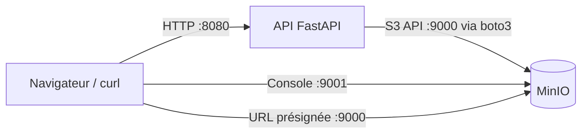

# Cloud Object Storage avec MinIO (Docker / Podman) + API

## 1. Qu'est-ce que le stockage objet ?

Il existe trois grandes familles de stockage :

| Type | Unité | Exemple | Usage typique |
|------|-------|---------|---------------|
| Bloc | blocs de taille fixe | disque SAN, EBS | bases de données, OS de VM |
| Fichier | fichiers dans une arborescence | NFS, SMB | partages de fichiers |
| **Objet** | **objet = données + métadonnées + clé unique** | **IBM COS, AWS S3, MinIO** | images, vidéos, sauvegardes, logs, data lakes |

Vocabulaire clé :

- **Bucket** : conteneur de plus haut niveau (son nom est unique). Ce n'est *pas* un dossier système.
- **Objet** : un fichier (n'importe quel contenu) stocké dans un bucket.
- **Clé (key)** : l'identifiant de l'objet dans le bucket, par exemple `photos/2024/chat.jpg`. Il n'y a pas de vrais dossiers : le `/` fait partie du nom.
- **Métadonnées** : informations associées à l'objet (type MIME, tags, date...).
- **API HTTP (REST)** : on accède aux objets via `PUT`, `GET`, `DELETE` sur des URLs, pas en montant un disque.

Propriétés du stockage objet :

- Très scalable (de quelques Mo à plusieurs Po) et peu coûteux.
- Durable (réplication, erasure coding).
- Accès via HTTP depuis n'importe où.
- Objets **immuables** : on remplace l'objet entier, on ne modifie pas quelques octets au milieu.
- Mal adapté aux écritures aléatoires fréquentes (ex. base de données).

**S3** (Amazon) est devenu l'API standard. IBM Cloud Object Storage, MinIO, Ceph, etc. sont compatibles S3.
Le même code `boto3` fonctionne donc en local avec MinIO et dans le cloud : seuls l'URL (`endpoint`) et les clés changent.

## 2. Architecture du TP



Fichiers du dépôt :

- [`docker-compose.yml`](docker-compose.yml) : lance MinIO + l'API
- [`Dockerfile`](Dockerfile) / [`main.py`](main.py) : l'API REST (FastAPI)
- [`app.py`](app.py) : petit script boto3 pour comprendre le SDK sans API

## 3. Lancer l'environnement

Prérequis : Docker (avec Compose) **ou** Podman (avec `podman compose`).

```bash
# Docker
docker compose up -d --build

# Podman
podman compose up -d --build
```

Vérification : `docker compose ps` doit afficher `minio` et `api` à l'état *running*.

Accès :

- Console web MinIO : <http://localhost:9001> (utilisateur `admin`, mot de passe `admin123`)
- API S3 : <http://localhost:9000>
- Documentation interactive de l'API (Swagger) : <http://localhost:8080/docs>

> Attention : ces identifiants sont réservés au TP. En production, on utilise des secrets, jamais des valeurs écrites dans le code.

### Alternative : MinIO seul, sans Compose

```bash
docker run -d --name minio -p 9000:9000 -p 9001:9001 \
  -e MINIO_ROOT_USER=admin -e MINIO_ROOT_PASSWORD=admin123 \
  -v minio-data:/data \
  cgr.dev/chainguard/minio server /data --console-address ":9001"
```

> Note : les images officielles `minio/minio` (quay.io et docker.io) ne sont plus téléchargeables anonymement (erreur `unauthorized`). Le TP utilise l'image `cgr.dev/chainguard/minio`, qui contient le même serveur MinIO.

(Remplacez `docker` par `podman` si besoin.)

## 4. Utiliser l'API

```bash
# 1. Créer un fichier de test
echo "Bonjour le stockage objet" > bonjour.txt

# 2. Uploader (le bucket est créé s'il n'existe pas)
curl -X POST -F "file=@bonjour.txt" http://localhost:8080/buckets/cours/upload

# 3. Lister les buckets
curl http://localhost:8080/buckets

# 4. Lister les objets d'un bucket
curl http://localhost:8080/buckets/cours/objects

# 5. Obtenir une URL de téléchargement temporaire (présignée)
curl http://localhost:8080/buckets/cours/download/bonjour.txt
```

Ouvrez l'URL renvoyée à l'étape 5 dans un navigateur : le fichier est servi **directement par MinIO**, sans passer par l'API.
Regardez ensuite la console web pour retrouver le bucket `cours` et votre objet.

### Notion à retenir : l'URL présignée

Le serveur signe (avec la clé secrète) une URL qui donne un accès temporaire à un seul objet.
Le client n'a pas besoin des identifiants et l'accès expire (ici 1 h). C'est le mécanisme standard pour partager un fichier privé.

## 5. Utiliser le SDK directement (boto3)

Avec MinIO lancé, installez les dépendances et exécutez le script :

```bash
pip install -r requirements.txt
python app.py
```

Lisez [`app.py`](app.py) : un client S3 = un `endpoint_url` + une clé d'accès + une clé secrète.
Pour passer à IBM Cloud Object Storage ou AWS S3, on change ces trois valeurs, pas la logique du code.

## 6. Exercices

1. Uploadez 3 fichiers dans 2 buckets différents puis listez-les. Que se passe-t-il si vous uploadez deux fois le même nom ?
2. Uploadez un fichier avec la clé `docs/2024/rapport.txt` (modifiez le code pour utiliser un chemin). La console affiche-t-elle des dossiers ? Ce sont des *préfixes*, pas de vrais dossiers.
3. Arrêtez et supprimez les conteneurs (`docker compose down`), puis relancez-les (`up -d`). Vos données sont-elles toujours là ? Pourquoi ? Essayez ensuite `down -v`.
4. Attendez l'expiration d'une URL présignée (ou modifiez `ExpiresIn` à 10 secondes) et constatez l'erreur.
5. **Bonus** : ajoutez à l'API une route `DELETE /buckets/{bucket}/objects/{key}` avec `s3.delete_object`.

## 7. Nettoyage

```bash
docker compose down        # arrête, garde les données (volume)
docker compose down -v     # arrête et supprime aussi les données
```

## 8. Dépannage

| Symptôme | Cause probable |
|----------|----------------|
| `port is already allocated` | un autre service utilise 9000, 9001 ou 8080 : changez le port à gauche dans `docker-compose.yml` |
| `Connection refused` sur `localhost:9000` | MinIO n'est pas démarré : `docker compose logs minio` |
| URL présignée inaccessible | vérifiez `MINIO_PUBLIC_ENDPOINT` (doit être joignable depuis votre navigateur) |
| Sous Podman, `podman compose` introuvable | installez `podman-compose` ou utilisez `docker-compose` avec le socket Podman |
